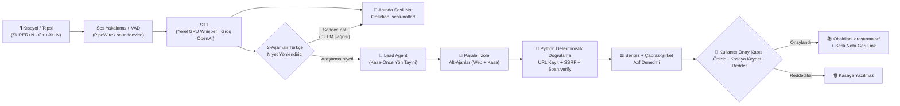

# SesliNot

[](https://github.com/fornhere/seslinot/actions/workflows/ci.yml)
[](https://www.python.org/downloads/)
[](#kurulum-linux-macos-windows)
[](LICENSE)

**Tek tuşla konuş → anında Obsidian sesli notuna dönüşsün. Cümlende "araştır" dersen → çok-ajanlı derin araştırma başlasın, kaynakları deterministik doğrulansın ve onayından sonra kasana yazılsın.**

---

## Nasıl Çalışır?



---

## Temel Özellikler

- **Sıfır Sürtünmeli Sesli Not:** Konuştuğun her şey önce anında Markdown olarak Obsidian kasandaki `sesli-notlar/YYYY-AA/` klasörüne atomik ve kilitli (`fcntl`/`msvcrt`) olarak kaydedilir; hiçbir fikir kaybolmaz.
- **Akıllı 2-Aşamalı Niyet Yönlendirici:** Normal notlarda **0 LLM çağrısı** (<1 ms ön-filtre). Cümlende araştırma talebi varsa (örn. *"SQLite WAL modunu derinlemesine araştır"*), arka planda niyeti netleştirir; geçmiş zaman/aktarma cümlelerini (*"dün araştırdım"*, *"Ahmet araştırıyormuş"*) yanlış tetiklemez.
- **4+1 Fazlı Çok-Ajanlı Derin Araştırma:**
  1. **Kasa-Önce Tarama (FTS5):** Önce senin kendi Obsidian notlarına bakar.
  2. **Lead Agent Planlama:** Konuyu alt başlıklara böler, izole alt-ajan direktifleri üretir.
  3. **Paralel Alt-Ajanlar:** Her alt-ajan ayrı bağlamla web + kasa bulgularını birebir alıntılarla toplar.
  4. **Deterministik Python Doğrulama (`Span.verify`):** URL'leri LLM değil Python yönetir; SSRF korumalı çekim, `www.` tekilleştirme, ölü URL temizliği ve birebir/yakın alıntı eşleştirmesi yapar.
  5. **Çapraz-Şirket Denetim:** Sentezi yazan modelden farklı şirket/model her atfı kaynakla karşılaştırır (`SUPPORTED` / `CONTRADICTED` / `UNSUPPORTED`); gerekirse 1 tur hedefli onarım yapar.
- **İnsan Onay Kapısı (Human-in-the-Loop):** Araştırma bittiğinde kasanı doğrudan kirletmez. Rapor önce `preview.md` olarak beklemeye alınır (`AWAITING_APPROVAL`), masaüstü bildirimi ve panel üzerinden **Önizle → Kasaya Kaydet / Reddet** onayına sunulur.
- **Çapraz Platform (Linux · macOS · Windows):**
  - **Linux (Omarchy / Hyprland / PipeWire):** Yerel GPU Whisper (`whisper-server` / `voxtype`), Hyprland kısayolları, `systemd` kullanıcı servisi ve native `forn.seslinot` Quickshell üst bar eklentisi.
  - **macOS & Windows:** PortAudio (`sounddevice`) kayıt, native bildirimler (`osascript` / PowerShell WinRT Toast), sistem tepsisi + global kısayol (`seslinot tray`), Cloud Whisper (Groq / OpenAI) ve Direct API (OpenAI-uyumlu / Anthropic + Tavily / Brave / DuckDuckGo) desteği.
- **Opsiyonel Hafıza OS Uyumu:** Herhangi bir standart Obsidian kasasıyla kutudan çıktığı gibi çalışır; kasan [Hafıza OS](https://github.com/fornhere/hafiza-os) yapısındaysa otomatik algılar (`hafiza_os_mode = "auto"`), yasaklı dizinlere dokunmaz ve `araştırmalar/` raporlarını salt-okunur bağlam olarak besler.

---

## Kurulum (Linux, macOS, Windows)

### Seçenek A — Masaüstü Uygulaması (Önerilen · Terminal Gerektirmez)

Windows, macOS ve Linux için **Tauri v2** tabanlı yerli masaüstü uygulaması (koyu Obsidian arayüzü, yüzen kayıt hapı HUD, canlı çok-ajanlı takip, tam Markdown onay önizleme ekranı, sistem tepsisi ve global kısayol):

1. [**GitHub Releases**](https://github.com/fornhere/seslinot/releases) sayfasından işletim sistemine uygun kurulum dosyasını indir:
   - **Windows:** `SesliNot_*_x64-setup.exe` (veya `.msi`)
   - **macOS (Apple Silicon):** `SesliNot_*_aarch64.dmg`
   - **Linux:** `SesliNot_*_amd64.AppImage` (veya `.deb`)
2. Uygulamayı aç → **3 adımlı kurulum sihirbazı** Obsidian kasanı otomatik bulur, STT ve AI profilini ayarlar.
3. Kısayol (**Windows/Linux:** `Ctrl + Alt + N`, **macOS:** `Cmd + Shift + N`) ile konuşmaya başla!

> Kaynaktan çalıştırmak için: `cd apps/desktop && npm install && npm run tauri dev`

### Seçenek B — CLI & Omarchy / Hyprland Kurulumu

Önkoşul: Python 3.12+ ve [`uv`](https://docs.astral.sh/uv/) (veya `pipx`).

#### 1. Paketi Kurun

**Windows ve macOS (sistem tepsisi, global kısayol ve mikrofon dahil):**
```bash
uv tool install "git+https://github.com/fornhere/seslinot.git[desktop]"
```

**Linux (Omarchy / PipeWire — hafif çekirdek):**
```bash
uv tool install "git+https://github.com/fornhere/seslinot.git"
```

#### 2. İlk Kurulum Sihirbazını Çalıştırın

`seslinot init`, sisteminizdeki Obsidian kasalarını `obsidian.json` üzerinden otomatik keşfeder, STT ve AI backend profilini algılayıp platforma uygun `config.toml` dosyasını oluşturur:

```bash
seslinot init
```

Otomatik / betik kurulum örneği (Cloud Groq STT + Direct API):
```bash
seslinot init --non-interactive --vault "~/Obsidian/Notlarim" --stt groq --backend api
```

#### 3. Çalıştırın

- **Windows / macOS (hafif tepsi modu):** `seslinot tray`
- **Linux (Omarchy / Hyprland):**
  `integrations/systemd/seslinotd.service`, `integrations/hyprland/bindings.lua` ve `integrations/omarchy-plugin/forn.seslinot/` dosyalarını kurarak `SUPER + N` (toggle), `SUPER + ALT + Z` (bas-konuş) ve `SUPER + SHIFT + R` (bar paneli) ile kullanabilirsiniz.

---

## STT ve Araştırma Profilleri

### Ses-Metin (STT) Seçenekleri (`[audio]` → `stt_provider`)

| Profil | Donanım İhtiyacı | Hız | Gerekli Ayar |
| :--- | :--- | :--- | :--- |
| **`local`** (varsayılan) | Yerel GPU / CPU (`whisper-server` veya `voxtype`) | ~0.3–1.2 sn | `stt_endpoint = "http://127.0.0.1:8178/v1/audio/transcriptions"` |
| **`groq`** | GPU gerekmez (Windows/Mac için ideal) | <1 sn | `GROQ_API_KEY` ortam değişkeni (`whisper-large-v3-turbo`) |
| **`openai`** | GPU gerekmez | ~1–2 sn | `OPENAI_API_KEY` ortam değişkeni (`whisper-1`) |
| **`custom`** | Herhangi bir OpenAI-uyumlu STT sunucusu | Değişken | `stt_endpoint` + `stt_api_key_env` |

### Araştırma Motoru Seçenekleri (`[research]`)

1. **Yerel AI CLI Modu (Abonelikli kullanıcılar):** Kurulu `claude`, `codex`, `agy` veya `opencode` CLI'larını izole çalışma dizinlerinde ve çapraz-şirket denetimle (örn. Claude sentez ↔ Codex denetim) çalıştırır.
2. **Direct API Modu (Yalnızca API anahtarı olan kullanıcılar):** `lead_backend = "api"`, `worker_backend = "api"`, `synth_backend = "api"`, `audit_backend = "api"` seçildiğinde `OPENAI_API_KEY` (veya OpenRouter/Ollama `api_base_url`) ya da `ANTHROPIC_API_KEY` + canlı web araması (Tavily `TAVILY_API_KEY` → Brave `BRAVE_API_KEY` → anahtarsız DuckDuckGo) ile çalışır.

---

## CLI Komut Referansı

| Komut | Açıklama |
| :--- | :--- |
| `seslinot init` | Çapraz-platform kurulum sihirbazı (Obsidian kasa keşfi + `config.toml`) |
| `seslinot doctor` | Platform araçları, mikrofon/STT, API anahtarı varlığı ve kasa sağlık testi |
| `seslinot tray` | Windows/macOS/X11 sistem tepsisi + global kısayol + gömülü daemon |
| `seslinotd` | Arka plan araştırma ve masaüstü durum daemon'ı |
| `seslinot record toggle\|start\|stop\|pause-toggle\|cancel` | Sesli kayıt kontrolü |
| `seslinot note "metin" [--research] [--run-now]` | Metin üzerinden not + niyet yönlendirme testi |
| `seslinot research "konu" [--quick] [--run-now] [--auto-save]` | Doğrudan çok-ajanlı derin araştırma başlat |
| `seslinot status [--json]` | Aktif oturumlar, onay bekleyenler ve son notlar |
| `seslinot-ctl preview <job_id>` | Kayıt onayı bekleyen raporun önizlemesini yazdır |
| `seslinot-ctl approve-report <job_id>` | Raporu Obsidian kasasına atomik kaydet ve sesli nota bağla |
| `seslinot-ctl reject-report <job_id>` | Raporu kasaya yazmadan reddet |

---

## Güvenlik ve Doğrulama İlkeleri

- **Gizlilik Duvarı (Privacy Firewall):** Dış web aramalarına giden sorgulardan yerel dosya yolları (`~/...`, `C:\...`), e-postalar, özel IP'ler, API anahtarları ve yapılandırılan kişisel terimler otomatik temizlenir.
- **Sır Maskeleme:** Kasa notlarına yazılmadan önce API anahtarları, Bearer token'lar ve özel anahtarlar deterministik regex kurallarıyla maskelenir.
- **SSRF Koruması:** Web içerik çekici özel ağ aralıklarını, loopback/metadata IP'lerini ve bunlara yönlendiren HTTP redirect'leri engeller.
- **Atomik & Kilitli Yazım:** Tüm Obsidian dosyaları çapraz-platform dosya kilidi (`fcntl.flock` / `msvcrt.locking`) + geçici dosya + `fsync` + `os.replace` ile yazılır; kullanıcı notunun hash'i değiştiyse üzerine yazılmaz.

---

## Geliştirme ve Testler

```bash
uv sync --extra dev
uv run pytest -q
```

Test paketi **245+ birim ve entegrasyon testinden** oluşur ve her commit'te GitHub Actions üzerinde **Linux, macOS ve Windows** matrisinde çalıştırılır.

## Lisans

[MIT](LICENSE) © 2026 Forn
